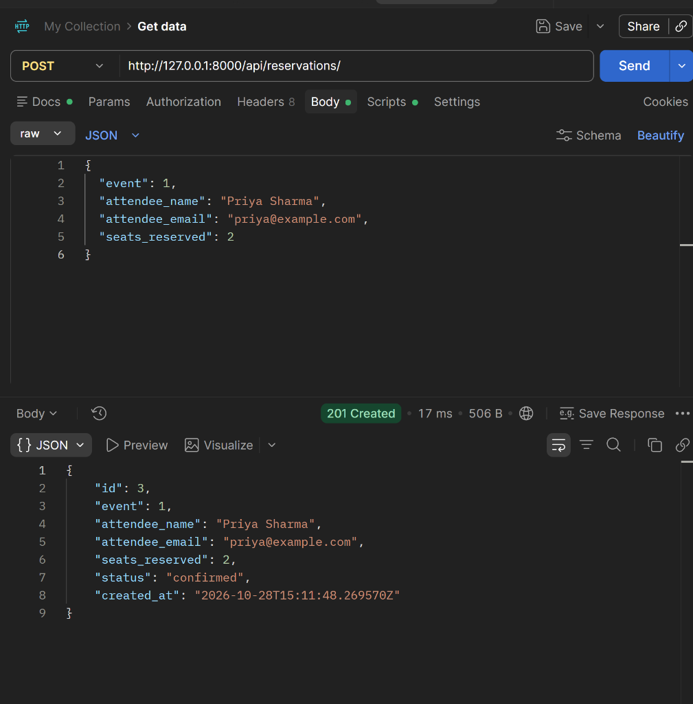
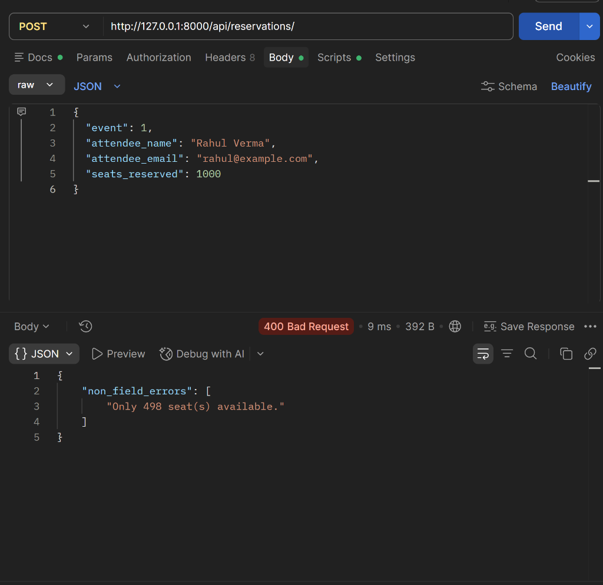
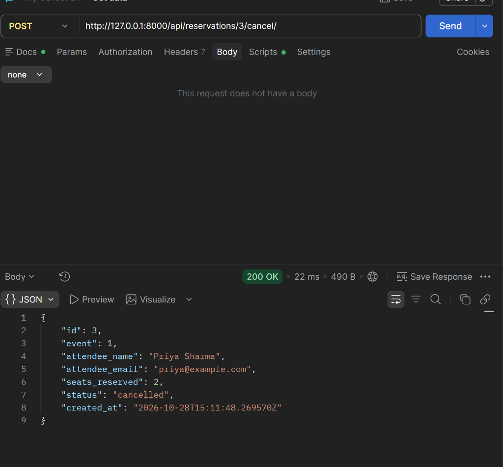

# EventHub - Event Ticket Reservation REST API

A robust, production-grade Django REST Framework backend for managing events and seat reservations, featuring atomic, row-locked concurrency control to prevent overselling, race conditions, and inventory drift.

---

## How to Run the Project

> **Requirement:** Python 3.10+ and **Django 5.1 or newer** (relies on SQLite's `transaction_mode: "IMMEDIATE"` option to serialize writers).

1. **Clone and navigate to the project directory:**
   ```bash
   cd eventhub
   ```

2. **Create and activate a virtual environment:**
   ```bash
   # On macOS/Linux:
   python3 -m venv .venv
   source .venv/bin/activate

   # On Windows:
   python -m venv .venv
   .venv\Scripts\activate
   ```

3. **Install dependencies:**
   ```bash
   pip install -r requirements.txt
   ```

4. **Verify Django version (must be 5.1+):**
   ```bash
   python -c "import django; print(django.VERSION)"
   ```

5. **Apply database migrations:**
   ```bash
   python manage.py migrate
   ```

6. **Start the development server:**
   ```bash
   python manage.py runserver
   ```
   The API will be available at `http://127.0.0.1:8000/api/`.

---

## Endpoints

| Method | URL | Purpose |
|---|---|---|
| GET | `/api/events/` | List events. Optional `?status=` and `?venue=` (case-insensitive contains) |
| POST | `/api/events/` | Create an event |
| GET | `/api/events/{id}/` | Retrieve one event, including `reservations_count` |
| PUT / PATCH | `/api/events/{id}/` | Update an event; rejected if it would break the seat invariant |
| DELETE | `/api/events/{id}/` | Delete an event (its reservations are cascade-deleted) |
| GET | `/api/reservations/` | List reservations. Optional `?event_id=` (positive integer) |
| POST | `/api/reservations/` | Reserve seats; deducts from `available_seats` atomically |
| GET | `/api/reservations/{id}/` | Retrieve one reservation |
| PUT / PATCH | `/api/reservations/{id}/` | Update attendee details only; `event` and `seats_reserved` can't change |
| DELETE | `/api/reservations/{id}/` | Delete a reservation; a confirmed one gives its seats back |
| POST | `/api/reservations/{id}/cancel/` | Cancel a reservation and restore its seats exactly once. No body |

### Sample Request and Response Bodies

#### 1. Create Event (`POST /api/events/`)
- **Request Body:**
  ```json
  {
    "title": "PyCon India 2025",
    "venue": "NIMHANS Convention Centre, Bangalore",
    "date": "2025-09-20",
    "total_seats": 500,
    "available_seats": 500,
    "status": "upcoming"
  }
  ```
- **Response (`201 Created`):**
  ```json
  {
    "id": 1,
    "title": "PyCon India 2025",
    "venue": "NIMHANS Convention Centre, Bangalore",
    "date": "2025-09-20",
    "total_seats": 500,
    "available_seats": 500,
    "status": "upcoming",
    "created_at": "2026-10-28T20:05:00.000000Z",
    "reservations_count": 0
  }
  ```

#### 2. Reserve Seats (`POST /api/reservations/`) - Success
- **Request Body:**
  ```json
  {
    "event": 1,
    "attendee_name": "Priya Sharma",
    "attendee_email": "priya@example.com",
    "seats_reserved": 2
  }
  ```
- **Response (`201 Created`):**
  ```json
  {
    "id": 1,
    "event": 1,
    "attendee_name": "Priya Sharma",
    "attendee_email": "priya@example.com",
    "seats_reserved": 2,
    "status": "confirmed",
    "created_at": "2026-10-28T20:06:00.000000Z"
  }
  ```

#### 3. Reserve Seats - Overbooking (`POST /api/reservations/`)
- **Request Body:**
  ```json
  {
    "event": 1,
    "attendee_name": "Rahul Verma",
    "attendee_email": "rahul@example.com",
    "seats_reserved": 1000
  }
  ```
- **Response (`400 Bad Request`):**
  ```json
  {
    "non_field_errors": [
      "Only 498 seat(s) available."
    ]
  }
  ```

#### 4. Cancel Reservation (`POST /api/reservations/{id}/cancel/`)
- **Request Body:** None
- **Response (`200 OK`):**
  ```json
  {
    "id": 1,
    "event": 1,
    "attendee_name": "Priya Sharma",
    "attendee_email": "priya@example.com",
    "seats_reserved": 2,
    "status": "cancelled",
    "created_at": "2026-10-28T20:06:00.000000Z"
  }
  ```
- **Calling cancel a second time (`400 Bad Request`):**
  ```json
  {
    "error": "Already cancelled."
  }
  ```

---

## Design Decision: Atomic, Row-Locked Seat Accounting

### What
Every operation modifying `available_seats` or reservation status executes within an atomic database transaction (`transaction.atomic()`). Rows are queried with row-level locking (`select_for_update()`), ensuring fresh data is fetched and availability is verified after locking the row.
SQLite operates with `transaction_mode: "IMMEDIATE"` and a 20-second timeout in `DATABASES["default"]["OPTIONS"]`, which forces SQLite to acquire an exclusive write lock immediately at `BEGIN`. On PostgreSQL, this identical code executes true row locks (`SELECT FOR UPDATE`) without modification.

### Why
The core risk in ticketing systems is concurrent booking: two users attempting to reserve the last remaining seat at the exact same moment. Standard application-level validation checks values that may become stale by the time `save()` is executed, resulting in oversold inventory or negative seat counts.

### Corner Cases Covered

| Corner Case | Description & Prevention |
|---|---|
| **Simultaneous booking of last seat** | `select_for_update()` inside `transaction.atomic()` re-evaluates `available_seats` under lock before deducting, rejecting racing requests once seats are exhausted. |
| **Double-clicked / concurrent cancel** | Reservation row is locked before status check. The first request changes status to `cancelled` and restores seats; the second sees `cancelled` and returns `400 {"error": "Already cancelled."}` without restoring seats twice. |
| **Event cancelled between validation and save** | Status is re-checked under lock in `ReservationSerializer.create()`. If an event was cancelled concurrently, the reservation raises a `400` validation error. |
| **Deleting a confirmed reservation** | `perform_destroy` runs inside an atomic block, locks the associated event row, and restores `available_seats` before deleting the reservation. Deleting a cancelled reservation does not restore seats. |
| **Editing `seats_reserved` or `event`** | Reservation updates strictly forbid modifying `event` or `seats_reserved` after creation, preventing bypass of seat accounting. |
| **Stale event edit overwriting deductions** | Event PUT/PATCH queries with `select_for_update()` inside `transaction.atomic()`, avoiding lost updates of concurrent seat deductions. |
| **Shrinking `total_seats` below booked count** | Event validation enforces the invariant `total_seats >= sum(confirmed seats)` and `available_seats <= total_seats - sum(confirmed seats)`. |
| **Malformed IDs causing 500s or silent coercion** | Client-supplied IDs are validated to ensure positive integer values. `true`, `1.5`, `"abc"`, `0`, or negative numbers immediately return `400 Bad Request`. |

### Trade-off
Locking rows serializes write operations targeting the same event. For this architecture and scale, this provides absolute consistency and zero seat leakage without distributed coordination. For massive, global flash sales, inventory sharding or an asynchronous queue-based booking buffer would be the next evolutionary step.

---

## Postman Screenshots

### 1. Successful Reservation (201 Created)


### 2. Overbooking (400 Bad Request)


### 3. Successful Cancellation (200 OK)

