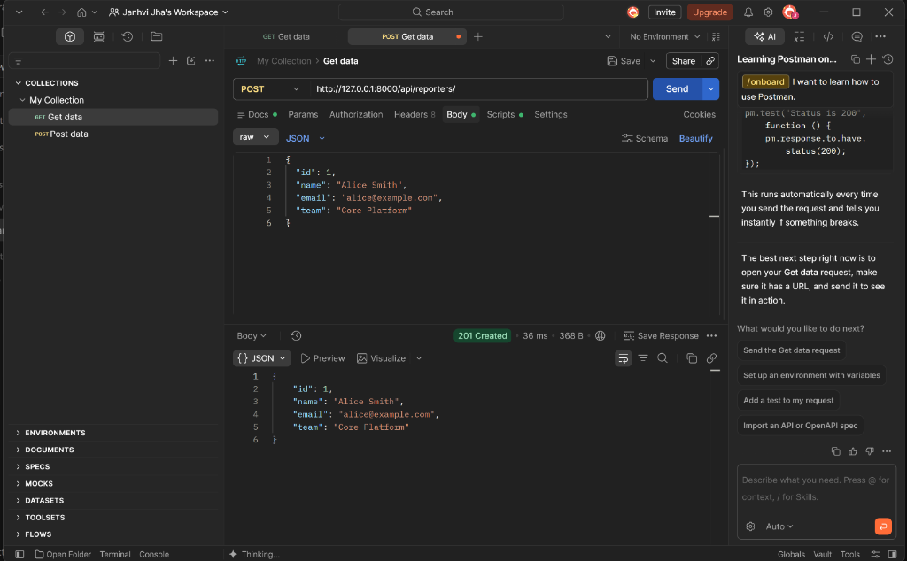
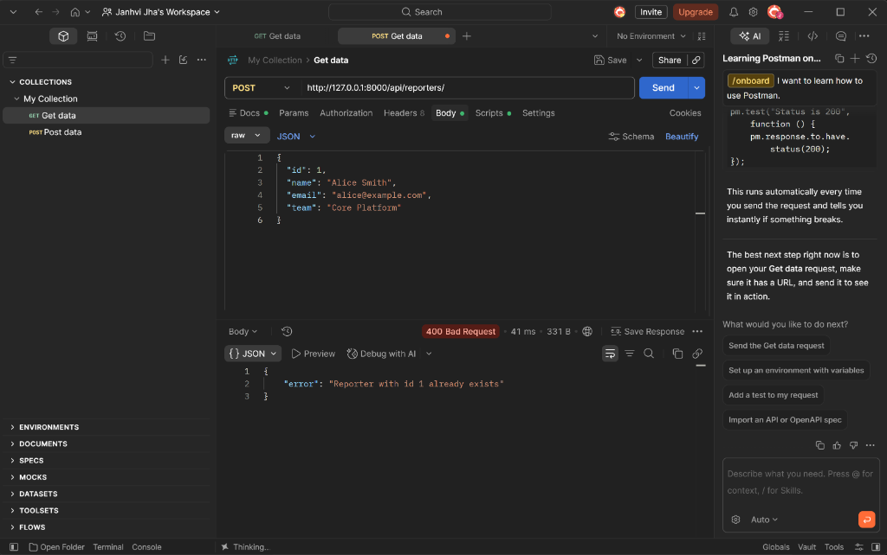

# DevTrack

DevTrack is a Django-based issue tracking REST API built with object-oriented domain models and thread-safe atomic JSON file persistence.

---

## How to Run the Project

### Prerequisites
- Python 3.10 or higher
- Django 5.x

### Setup & Execution
1. Install Django if you haven't already:
   ```bash
   pip install django
   ```

2. Navigate to the project directory:
   ```bash
   cd devtrack
   ```

3. Start the development server:
   ```bash
   python manage.py runserver
   ```

4. The server runs at `http://127.0.0.1:8000/`. API endpoints are accessible under `http://127.0.0.1:8000/api/`.

*(Note: Data is automatically persisted to `reporters.json` and `issues.json` in the project root. If these files are absent, they are automatically initialized with an empty list `[]` on startup and upon file access.)*

---

## API Endpoints

### 1. Reporters Endpoints (`/api/reporters/`)

#### `POST /api/reporters/`
Creates a new reporter.
- **Payload:**
  ```json
  {
    "id": 1,
    "name": "Alice Smith",
    "email": "alice@example.com",
    "team": "Core Platform"
  }
  ```
- **Validation Rules:**
  - `id`: Required.
  - `name`: Must not be empty.
  - `email`: Must contain `@`.
  - `team`: Must not be empty.
  - Cannot duplicate an existing reporter's ID.
- **Success Response (201 Created):**
  ```json
  {
    "id": 1,
    "name": "Alice Smith",
    "email": "alice@example.com",
    "team": "Core Platform"
  }
  ```
- **Error Response (400 Bad Request):**
  - Validation error: `{"error": "<validation message>"}`
  - Duplicate ID: `{"error": "Reporter with id 1 already exists"}`
  - Malformed JSON: `{"error": "Malformed JSON"}`

#### `GET /api/reporters/`
Retrieves reporters.
- **Without query param:** Returns an array of all reporters (`200 OK`).
- **With query param `?id=<id>`:**
  - If found: Returns the matching reporter object (`200 OK`).
  - If not found: Returns `{"error": "Reporter not found"}` (`404 Not Found`).

---

### 2. Issues Endpoints (`/api/issues/`)

#### `POST /api/issues/`
Creates a new issue and assigns polymorphic behavior based on `priority`.
- **Payload:**
  ```json
  {
    "id": 101,
    "title": "Payment gateway timeout",
    "description": "Requests timeout after 30s",
    "status": "open",
    "priority": "critical",
    "reporter_id": 1
  }
  ```
- **Validation Rules:**
  - `id`: Required, must be unique.
  - `reporter_id`: Must reference an existing reporter in `reporters.json` (returns `{"error": "Reporter does not exist"}` if not found).
  - `title`: Must not be empty.
  - `status`: Must be one of `open`, `in_progress`, `resolved`, `closed`.
  - `priority`: Must be one of `low`, `medium`, `high`, `critical`.
- **Polymorphic Priority Handling:**
  - `critical` &rarr; Instantiates `CriticalIssue`. Message: `[URGENT] {title} — needs immediate attention`
  - `low` &rarr; Instantiates `LowPriorityIssue`. Message: `{title} — low priority, handle when free`
  - `medium` / `high` &rarr; Instantiates `Issue`. Message: `{title} [{priority}]`
- **Success Response (201 Created):**
  ```json
  {
    "id": 101,
    "title": "Payment gateway timeout",
    "description": "Requests timeout after 30s",
    "status": "open",
    "priority": "critical",
    "reporter_id": 1,
    "created_at": "2026-10-11 23:00:00.123456",
    "message": "[URGENT] Payment gateway timeout — needs immediate attention"
  }
  ```

#### `GET /api/issues/`
Retrieves issues.
- **Without query params:** Returns all issues (`200 OK`).
- **With `?id=<id>`:**
  - Returns matching issue object (`200 OK`), or `{"error": "Issue not found"}` (`404 Not Found`).
- **With `?status=<status>`:**
  - Returns filtered array of issues matching status (`200 OK`). Returns `[]` if no matches found.

---

## Design Decision: Thread-Safe Atomic JSON Persistence

### The Problem
When using flat JSON files for persistence in a web application, concurrent `POST` requests create race conditions. If two threads read the file simultaneously, append their item, and write back, one write silently overwrites the other (the lost-update anomaly). Furthermore, a crash or interrupted write can leave the file half-written and corrupt the JSON syntax.

### The Solution
A two-step synchronization and atomic write strategy was implemented in `issues/views.py`:
1. **Per-file Re-entrant Locks (`threading.RLock`)**: Read-modify-write sequences are synchronized using threading locks. This guarantees that checking for duplicate IDs, verifying foreign-key references, and appending new items happen in an isolated critical section.
2. **Atomic Temp-File Replacement**: When saving data, the payload is dumped to a temporary file (`tempfile.NamedTemporaryFile`) created in the *same directory* as the target file. The file is flushed, synced to disk (`os.fsync`), closed, and replaced using `os.replace`. Because both the temp file and the target reside on the same drive volume, `os.replace` executes as an atomic file system operation (invoking `MoveFileExW` on Windows NTFS and `rename` on POSIX), preventing file corruption during power failures or sudden process termination.

---

## Postman Testing Screenshots

### 1. Success Case: Creating a Reporter (`201 Created`)
Request to `POST /api/reporters/` creating a new reporter entity.



---

### 2. Failure Case: Duplicate Reporter ID (`400 Bad Request`)
Sending the same `POST /api/reporters/` request again triggers validation error: `{"error": "Reporter with id 1 already exists"}`.


